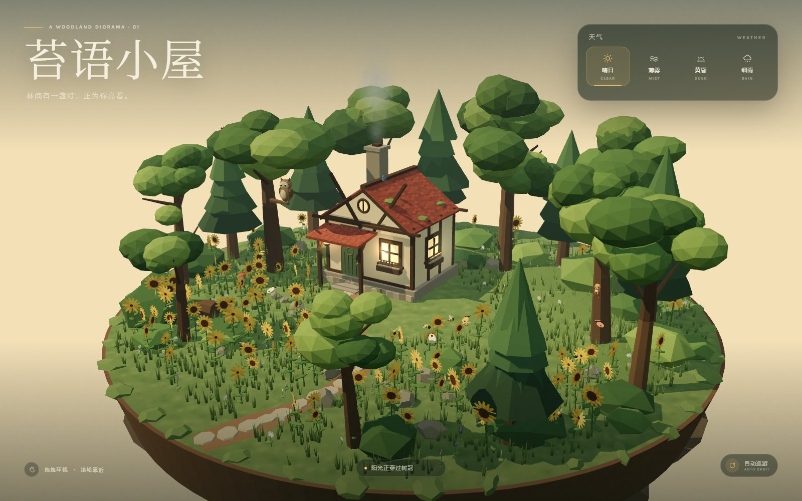
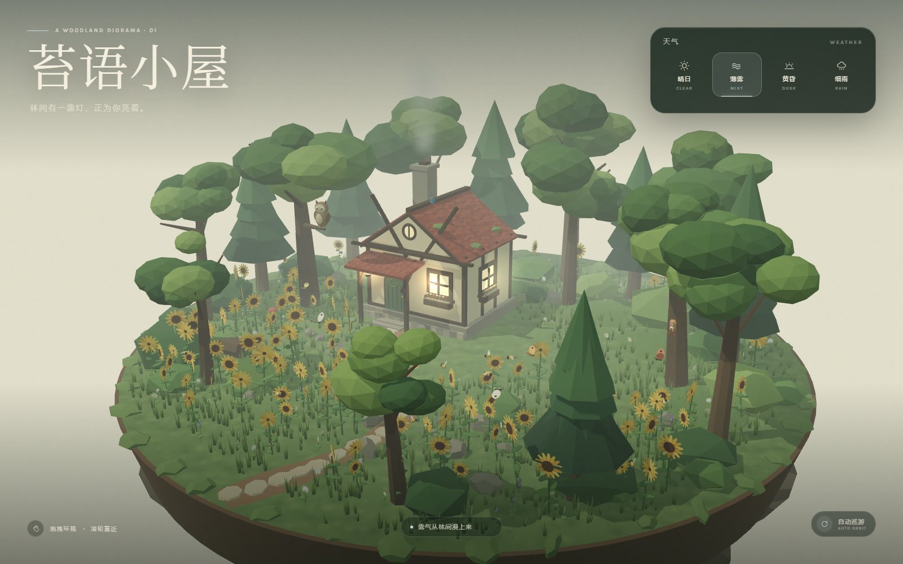
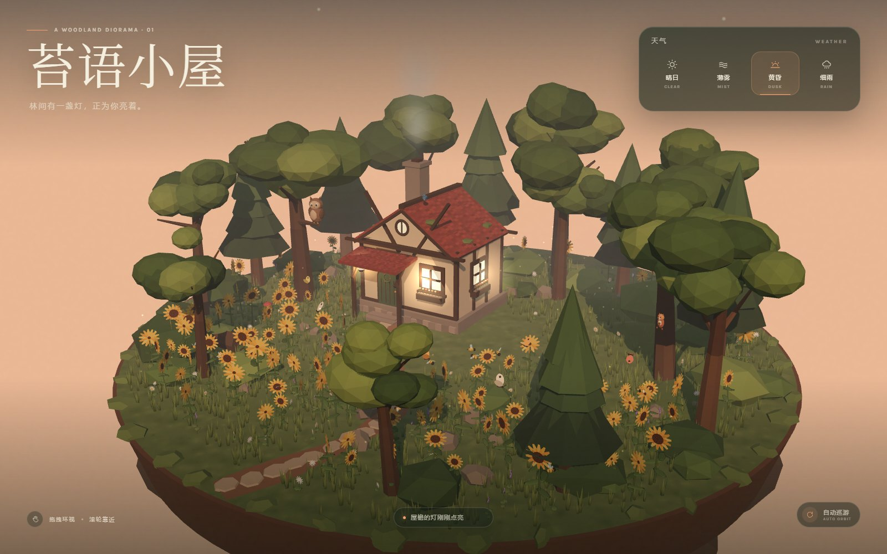
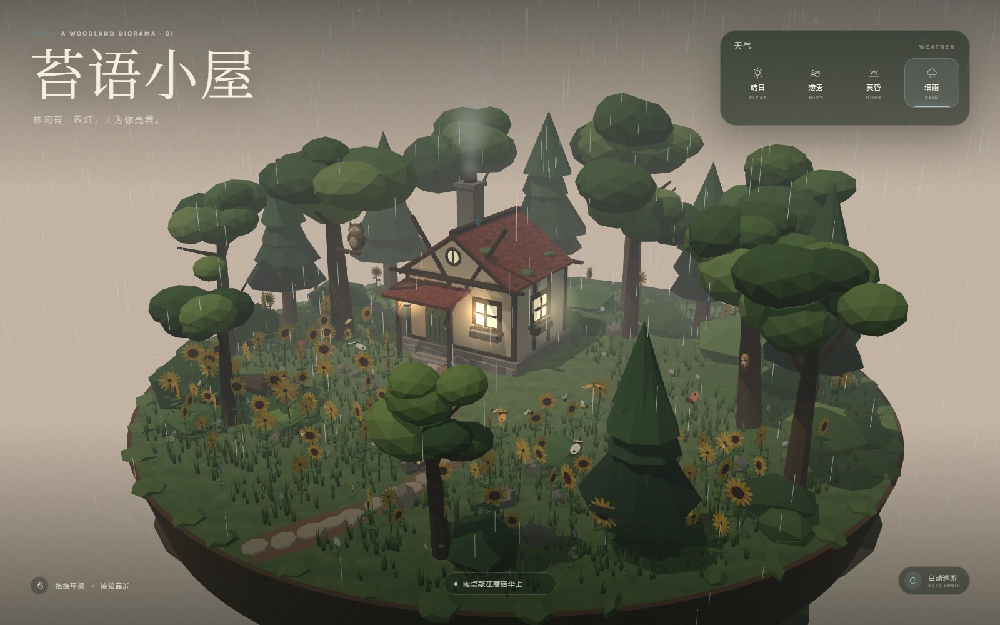

<div align="center">

# 苔语小屋 · Moss & Meadow

**一座藏在森林里的低多边形小屋。**

**简体中文** · [English](README.en.md)

[在线体验](https://moss-and-meadow.pages.dev/) · [GitHub](https://github.com/hefuhai001/small-house-in-forest)

</div>

<p align="center">
  <a href="https://moss-and-meadow.pages.dev/">
    
  </a>
  <br />
  <sub>晴日 · 阳光正穿过树冠</sub>
</p>

## 关于这个场景

苔语小屋是一个使用 **Three.js** 手工搭建的互动立体模型。场景中的地形、木屋、树木、花草、动物与天气系统全部由代码程序化生成，没有使用外部 3D 模型或贴图素材。

它希望保留童话绘本般的安静气质：低多边形的树冠、暖色窗光、屋前摇曳的向日葵，以及顺着林间小路走进画面的风。

## 场景里有什么

- **森林木屋**：木质框架、苔藓陶瓦屋顶、拱形木门、花箱、门廊、灯笼与烟囱炊烟。
- **林间动物**：树枝上会转头和眨眼的猫头鹰、树干上的松鼠，以及屋顶的蓝色小鸟。
- **向日葵花田**：大片低多边形向日葵、雏菊、薰衣草和高低错落的草丛，随风轻轻摆动。
- **蝴蝶与蜜蜂**：蝶翼持续扇动并沿曲线飞行，蜜蜂在向日葵之间悬停穿梭。
- **四种天气**：晴日、薄雾、黄昏、细雨，天空、雾、光照、窗光、雨丝与萤火虫会平滑过渡。
- **自由视角**：拖拽环绕、滚轮拉近，也可以开启自动巡游，让镜头慢慢绕着小屋旋转。
- **完整氛围层**：漂浮的立体地块、飘动的云、黄昏萤火、烟囱炊烟与响应式玻璃质感界面。

## 天气一览

<table>
  <tr>
    <td width="50%" align="center">
      
      <br />
      <sub><strong>晴日 CLEAR</strong> · 阳光正穿过树冠</sub>
    </td>
    <td width="50%" align="center">
      
      <br />
      <sub><strong>薄雾 MIST</strong> · 雾气从林间漫上来</sub>
    </td>
  </tr>
  <tr>
    <td width="50%" align="center">
      
      <br />
      <sub><strong>黄昏 DUSK</strong> · 屋檐的灯刚刚点亮</sub>
    </td>
    <td width="50%" align="center">
      
      <br />
      <sub><strong>细雨 RAIN</strong> · 雨点敲在蘑菇伞上</sub>
    </td>
  </tr>
</table>

## 操作方式

| 操作 | 效果 |
| --- | --- |
| 拖拽画面 / 单指滑动 | 环绕查看整座森林小屋 |
| 滚轮 / 双指捏合 | 拉近或拉远镜头 |
| 右上角天气按钮 | 切换晴日、薄雾、黄昏、细雨 |
| 数字键 `1` `2` `3` `4` | 快速切换四种天气 |
| 右下角「自动巡游」 | 开启或关闭镜头自动环绕 |

## 技术栈

- **Three.js**：场景、材质、光照、阴影与动画
- **Vite**：本地开发与生产构建
- **Cloudflare Pages**：静态部署
- **Canvas 程序化纹理**：草地、屋瓦、木牌与柔和光晕
- **InstancedMesh**：批量绘制草丛、向日葵、雏菊与薰衣草
- **ShaderMaterial**：天空渐变、雾色与花草原地摆动
- **ACES Filmic Tone Mapping**：暖色高光与黄昏氛围

场景没有加载任何外部模型、HDR 或图片贴图，所有视觉元素都在运行时生成。

## 本地运行

需要 Node.js 20.19+ 或 22.12+。

```bash
npm install
npm run dev
```

打开终端输出的本地地址即可预览。

生产构建：

```bash
npm run build
npm run preview
```

## 部署到 Cloudflare Pages

```bash
npx wrangler pages deploy dist --project-name=moss-and-meadow --branch=main
```

当前线上版本：

**[https://moss-and-meadow.pages.dev/](https://moss-and-meadow.pages.dev/)**

## 项目结构

```text
.
├── index.html                 # 页面结构、天气面板与加载界面
├── src/
│   ├── main.js                # 渲染器、相机、交互与动画循环
│   ├── style.css              # 界面视觉与响应式布局
│   ├── utils.js               # 随机数、纹理与几何合并工具
│   └── scene/
│       ├── terrain.js         # 漂浮地块、小路、石块与蘑菇
│       ├── cabin.js           # 森林小屋、窗光、灯笼与炊烟
│       ├── forest.js          # 树木、灌木、倒木与小动物落脚点
│       ├── meadow.js          # 向日葵、雏菊、薰衣草与草叶
│       ├── creatures.js       # 猫头鹰、松鼠、小鸟、蝴蝶与蜜蜂
│       └── weather.js         # 四种天气、天空、云、雨、雾与萤火
├── screenshots/               # README 展示图
└── package.json
```

## 说明

- 建议使用支持 WebGL 2 的现代浏览器（Chrome、Edge、Safari 或 Firefox）。
- 场景会依据屏幕尺寸自动调整界面布局；移动端同样支持触摸旋转和缩放。
- 实时渲染包含阴影、粒子与大量实例化植被，桌面端体验最佳。
